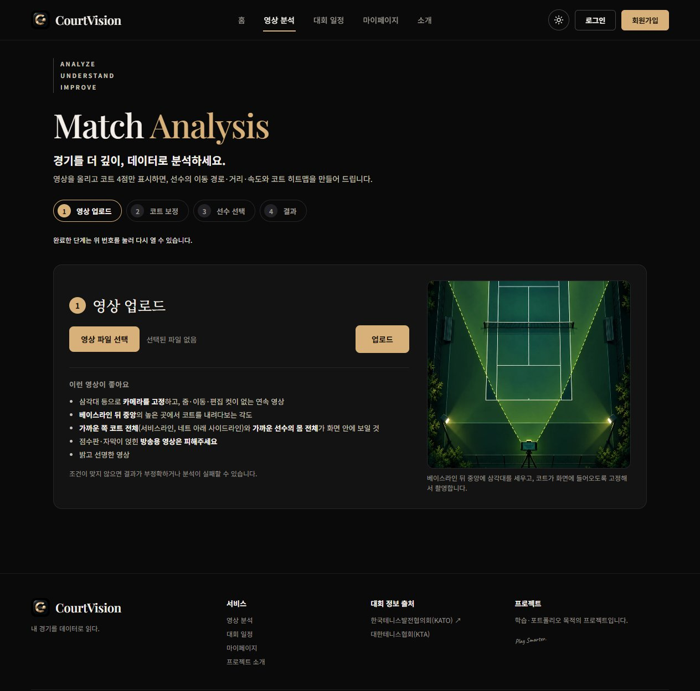
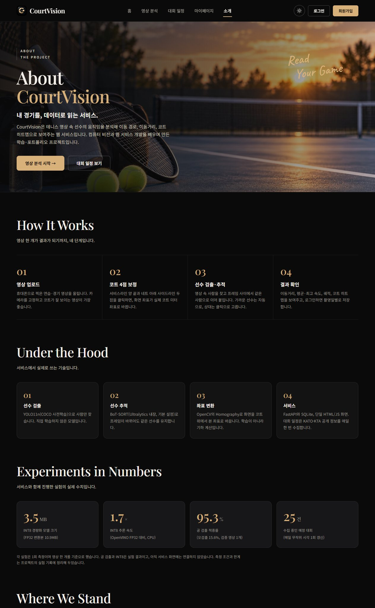

# CourtVision

테니스 경기 영상을 올리면 선수를 추적해 이동 경로·이동거리·속도·코트 히트맵을 보여주는 웹 서비스입니다.
컴퓨터 비전(검출·추적)과 웹 서비스 개발, 크롤링을 함께 배우며 만든 학습·포트폴리오 프로젝트입니다.


## 무엇을 할 수 있나요

- **영상 분석**: 영상을 올리고 코트 4점만 클릭하면, 화면 좌표를 실제 코트 좌표(미터)로 바꿔서 선수의 이동거리·평균/최고 속도·이동 궤적·코트 히트맵을 만들어 드립니다.

  

- **대회 일정**: 한국테니스발전협의회(KATO), 대한테니스협회(KTA)가 공개한 국내 아마추어 대회 일정을 모아서 보여드립니다. 대회 정보가 바뀌면 변경 이력을 남깁니다.

  

- **로그인 · 마이페이지**: 로그인하면 분석 결과를 촬영일별로 저장하고 다시 확인할 수 있습니다.
- 다크/라이트 테마, 모바일 화면 지원.

## 사용 기술

| 영역 | 기술 |
|---|---|
| 선수 검출 | YOLO11n (COCO 사전학습, person 클래스) |
| 선수 추적 | BoT-SORT (Ultralytics 내장) |
| 좌표 변환 | OpenCV Homography (사용자가 클릭한 코트 4점 기준) |
| 백엔드 | FastAPI + SQLite |
| 프론트엔드 | HTML/CSS/JS 단일 페이지 (별도 프레임워크 없음) |
| 크롤링 | requests + BeautifulSoup (서버 렌더링 페이지) |
| 배포 | Docker (로컬 컨테이너 실행까지 확인) |

## 실행 방법

### 로컬에서 직접 실행
```bash
cd webapp/backend
pip install -r requirements.txt
uvicorn main:app --port 8000
```
`http://localhost:8000` 접속. 첫 실행 시 YOLO11n 가중치를 자동으로 내려받습니다.

### Docker로 실행
```bash
docker compose up --build
```

### 환경변수 (선택)
`COURTVISION_DB`, `UPLOAD_DIR`, `RESULTS_DIR`, `YOLO_IMGSZ`, `COOKIE_SECURE`(HTTPS 배포 시 1)

## 프로젝트 소개 화면



## 실험 기록

별도로 진행한 실험들의 조건·결과·한계를 정직하게 기록해 두었습니다.

- [`results/v2_ball_experiment.md`](results/v2_ball_experiment.md) — 공 검출 모델 파인튜닝 (v1~v3a). 공개 데이터 추가가 오히려 성능을 악화시킨 사례와 원인 검증 과정 포함.
- [`results/int8_experiment.md`](results/int8_experiment.md) — 선수 검출 모델의 INT8/OpenVINO 경량화 실험. 1차 측정이 조건 불일치로 잘못됐던 과정과 재측정 결과 포함.

## 지금 안 되는 것 (정직하게)

- 공은 **검출까지만** 했고, 프레임 간 추적(궤적)은 하지 않았습니다. 서비스에도 연결돼 있지 않습니다.
- 이동거리·속도는 **참고용 추정값**입니다. 실측값과 비교 검증하지 않았습니다.
- 코트 보정은 4점을 직접 클릭해야 합니다 (자동 인식 아님).
- Docker는 로컬 컨테이너 실행까지만 확인했고, 외부에서 접속 가능한 서버 배포는 아직입니다.

## 데이터 출처

대회 정보는 [한국테니스발전협의회(KATO)](https://kato.kr)와 대한테니스협회(KTA)가 공개한 일정을 요약한 것이며, 정확한 내용은 각 대회의 원본 링크에서 확인해야 합니다. 화면의 사진은 분위기를 위한 AI 생성 이미지입니다.

## 폴더 구조
```
webapp/backend/   FastAPI 서버, 크롤러, DB
webapp/frontend/  단일 HTML/JS 프론트
src/              실험·검증 스크립트 (공 학습/평가, INT8 등)
results/          실험 기록
```
