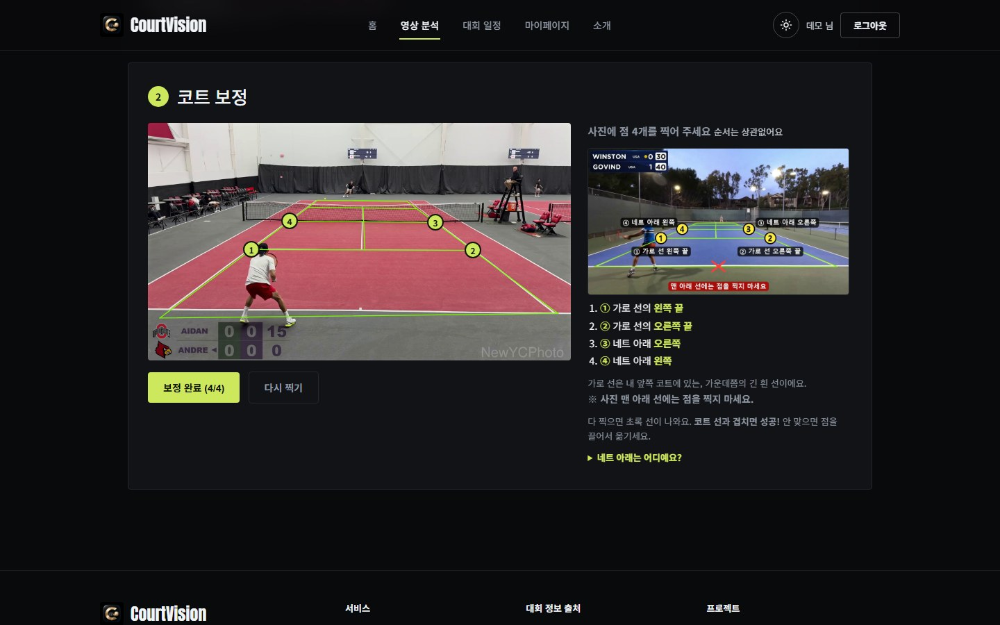
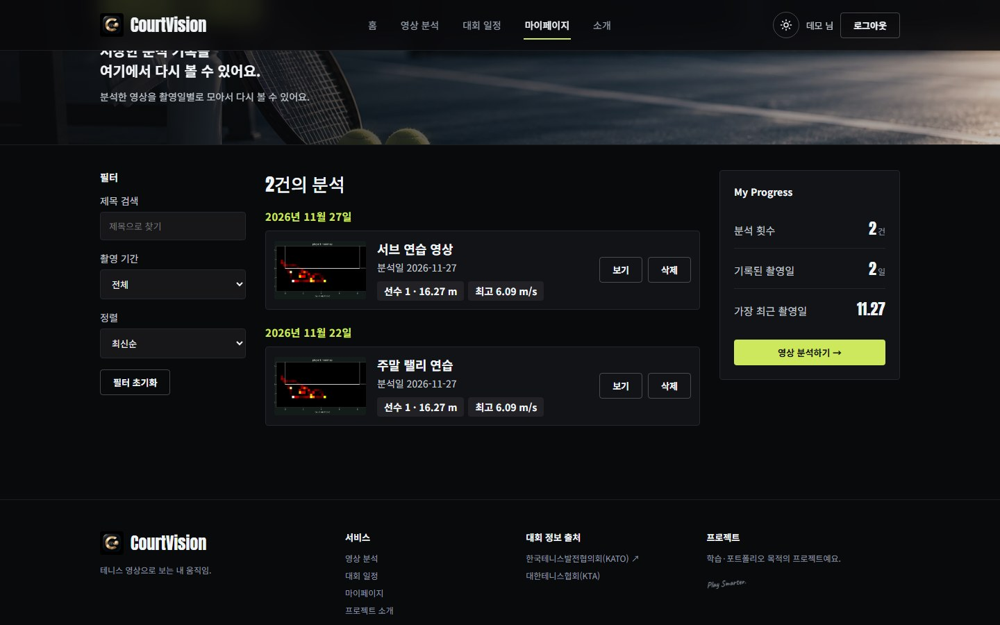
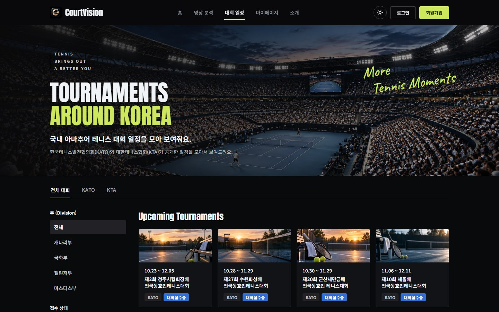
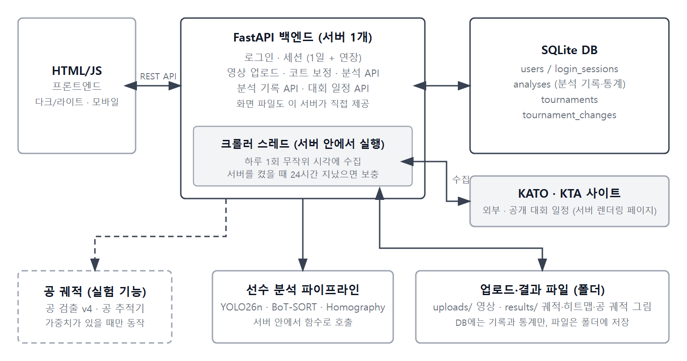
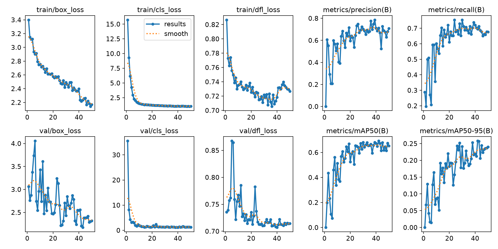
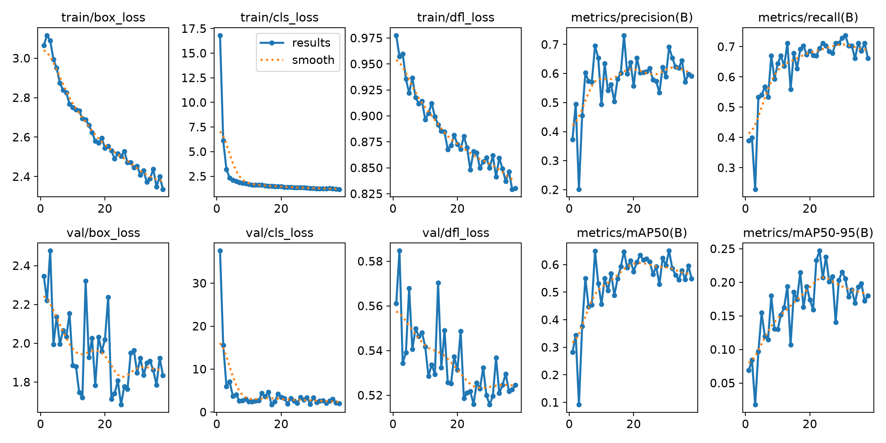
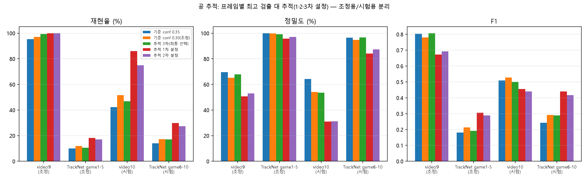
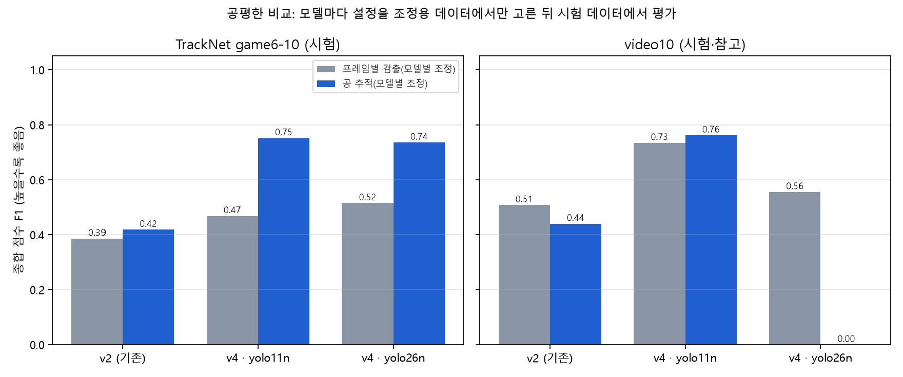
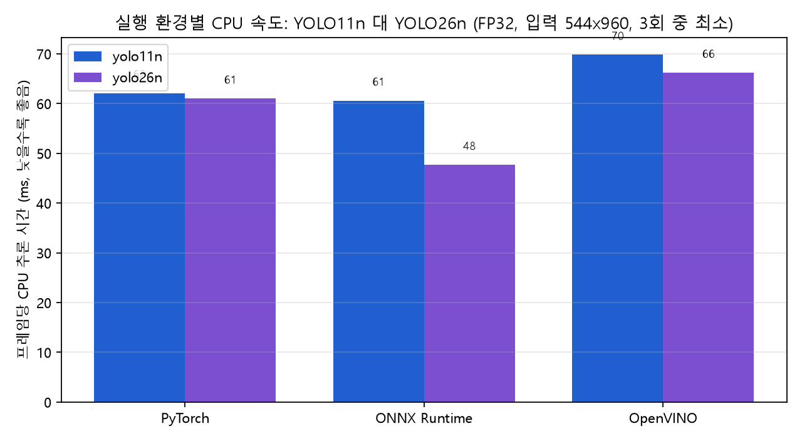

<div align="center">

# CourtVision _ 테니스 경기 영상 분석 웹 서비스

YOLO·BoT-SORT·Homography 기반 **선수 추적 웹 서비스**와 공 검출·추적·모델 비교 실험

**개인 프로젝트 · 기간 2026.09 ~ 2026.11**

<br>


<br>

`YOLO26n` · `BoT-SORT` · `OpenCV` · `PyTorch` · `OpenVINO` · `FastAPI` · `SQLite` · `JavaScript` · `Docker` · `pytest`

</div>

---

## 1. 프로젝트 개요

테니스 경기 영상을 올리고 코트 4점을 클릭하면, 선수를 추적해 이동 궤적과 코트 히트맵을 보여 주는 웹 서비스

- **배경**: 아마추어 선수는 경기 영상을 찍어도 분석할 방법이 없고, 국내 대회 일정은 협회 사이트마다 흩어져 있음
- **문제**: 영상 속 화면 좌표는 실제 코트 위치와 달라 선수의 움직임을 코트 기준으로 볼 수 없음
- **담당**: 요구사항 정의 · 실험 설계와 결과 검토 · 검증 질문
- **기능**
  - 선수 추적: 영상 업로드 → 코트 4점 클릭 → 카메라에서 가까운 선수 한 명 검출·추적 → 실제 코트 좌표(m) 변환 → 궤적·히트맵
  - 대회 일정: KATO·KTA 공개 일정 자동 수집·조회
  - 회원 기능: 로그인, 촬영일별 분석 기록 저장, 마이페이지
  - 공 궤적(실험 기능): 분석 결과에 공이 지나간 선을 함께 표시
- **실험**: 공 검출 파인튜닝, 공 추적기, 모델 비교(YOLO11n·26n 등), INT8 경량화 (INT8은 서비스 미연결)

<details>
<summary><b>용어 풀이</b></summary>

<br>

| 용어 | 뜻 |
|---|---|
| 검출 · 추적 | 검출은 한 프레임에서 선수의 위치를 찾는 것, 추적은 프레임이 바뀌어도 같은 선수에 같은 번호(추적 번호)를 유지하는 것 |
| BoT-SORT | 추적 번호를 유지하는 추적 방식. Ultralytics에 내장 |
| Homography | 영상 속 코트 4점을 실제 코트 4점에 대응시켜 화면 좌표를 코트 좌표(m)로 바꾸는 변환 |
| 히트맵 | 선수가 코트 어느 곳에 오래 머물렀는지 색으로 표시한 그림 |
| 재현율 · 정밀도 · F1 | 재현율은 실제 공 중 찾아낸 비율, 정밀도는 찾아냈다고 한 것 중 맞은 비율, F1은 둘을 합친 종합 점수 |
| 적중 | 정답 위치에서 20px 이내(영상 너비 1920 기준)에 검출한 경우 |
| 공 추적기 | 프레임별 공 후보를 이동 속도·끊김 비용으로 이어 하나의 궤적으로 만드는 후처리(학습 없음) |
| INT8 양자화 | 모델 계산 정밀도를 낮춰 크기와 CPU 추론 시간을 줄이는 경량화 |
| ONNX Runtime · OpenVINO | 학습한 모델을 PyTorch 밖에서 빠르게 실행하는 추론 엔진 |

</details>

### 1-1. 핵심 성과

| 항목 | 결과 | 상세 |
|---|---|---|
| 공 검출·추적 | 처음 보는 방송 영상에서 종합 점수(F1) **0.42 → 0.75** | [6-2](#6-2-공-검출-v4와-공-추적기) |
| 모델 교체 | YOLO11n → **YOLO26n**, 가까운 선수 기준 정확도 동급·속도 같거나 빠름 | [6-3](#6-3-yolo11n-대-yolo26n-비교와-서비스-모델-교체) |
| 정직한 검증 | 잘못된 결론을 **두 번 직접 정정**하고 과정을 문서화 | [7-5](#7-5-모델-교체-검증-중-잘못된-결론을-두-번-정정) |
| 품질 | 자동 테스트 **88개**, Docker 빌드·실행 확인 | [5장](#5-기능), [10장](#10-설치-및-실행) |

---

## 2. 주요 화면

<table>
<tr>
<td width="50%" valign="top">

<p align="left"><b>① 영상 분석 · 코트 4점 찍기</b><br>큰 예시 그림과 쉬운 안내, 초록 선이 코트 선과 겹치면 성공</p>
</td>
<td width="50%" valign="top">

<p align="left"><b>② 영상 분석 · 분석 결과</b><br>가까운 선수 추적, 히트맵, 공 궤적(실험 기능), 자동 저장 (참고용 추정값)</p>
</td>
</tr>
<tr>
<td width="50%" valign="top">

<p align="left"><b>③ 마이페이지</b><br>촬영일별 분석 기록, 다시 보기·삭제</p>
</td>
<td width="50%" valign="top">

<p align="left"><b>④ 대회 일정</b><br>KATO·KTA 일정 수집, 출처·부별·접수중 필터</p>
</td>
</tr>
</table>

---

## 3. 서비스 구조

<p align="center">
  
</p>

<details>
<summary><b>자세한 구조 보기</b> (크롤러 스레드, 외부 사이트, 분석 모듈)</summary>

<br />

<p align="center">
  
</p>

- 크롤러는 별도 프로그램이 아니라 **서버 안에서 도는 스레드**(서버를 켤 때 시작, 하루 1회 무작위 시각에 수집)
- 영상 분석은 서버가 **함수로 직접 호출**(별도 서버 없음), 공 궤적은 가중치 파일이 있을 때만 동작
- 업로드 영상과 결과 그림은 DB가 아니라 **폴더**(`uploads/`, `results/`)에 저장, DB에는 기록과 통계만 저장

</details>

### 3-1. DB 관계도

<p align="center">
  
</p>

- 로그인 토큰은 해시로만 저장, 비밀번호는 솔트 해시로 저장
- 업로드 영상과 분석 결과 이미지는 서버 폴더(`uploads/`, `results/`)에 저장, 분석 기록 DB에는 통계와 결과 경로 저장

---

## 4. 처리 흐름

### 4-1. 영상 분석 흐름

<p align="center">
  
</p>

| 단계 | 화면 동작 | 서버 처리 |
|---|---|---|
| 1. 업로드 | 영상 선택 후 업로드 | `POST /api/upload`: 영상 저장, 첫 프레임 반환 |
| 2. 프레임 선택 | 코트와 선수가 잘 보이는 시각 선택(선택 사항) | `POST /api/set_frame`: 해당 시각의 프레임 반환 |
| 3. 코트 보정 | 프레임에서 코트 4점 클릭 | `POST /api/calibrate`: Homography 계산, **영상 전체 선수 추적(가장 오래 걸리는 단계)**, 선택 시각에 코트 안에서 가장 큰 박스(= 카메라에서 가까운 선수)를 player1로 자동 선택 |
| 4. 분석 | 빨간 박스가 가까운 선수인지 확인 후 분석 시작 | `POST /api/analyze`: 가까운 선수 한 명의 추적 결과 → 코트 좌표 변환 → 궤적·히트맵·통계, 공 궤적(실험 기능, 공 모델 가중치가 있을 때) |
| 5. 저장 | 촬영일·제목 입력 후 저장 | 로그인 회원의 분석 기록 저장, 마이페이지에서 조회·삭제 |

<details>
<summary><b>API 목록 보기</b></summary>

<br>

| 구분 | 엔드포인트 |
|---|---|
| 영상 분석 | `POST /api/upload`, `/api/set_frame`, `/api/calibrate`, `/api/analyze` |
| 계정 | `POST /api/signup`, `/api/login`, `/api/logout`, `/api/session/extend`, `GET /api/me` |
| 기록 | `GET /api/analyses`, `DELETE /api/analyses/{id}` |
| 대회 | `GET /api/tournaments` (출처·접수중 필터) |

</details>

---

## 5. 기능

### 5-1. 선수 추적 · 영상 분석 파이프라인

- YOLO26n으로 사람 검출(conf 0.3, imgsz 960), BoT-SORT로 추적 번호 유지
- OpenCV Homography로 화면 좌표를 실제 코트 좌표(m)로 변환, 클릭 순서가 달라도 자동 정렬
- 가까운 선수 한 명의 이동 궤적 이미지와 코트 히트맵 산출 (먼 쪽 선수는 작게 찍혀 추적 번호가 쪼개지기 쉬워 분석하지 않음)
- 4단계 스텝 위저드 UI, 로그인 시 촬영일별 저장

### 5-2. 대회 일정 크롤링 · DB

- KATO·KTA 공개 일정 수집, `requests + BeautifulSoup` (서버 렌더링 확인 후 선택)
- `upsert()`로 신규·변경·동일 구분, 변경 이력 테이블 별도 관리
- 수집 주기: 일 1회, 매번 다른 무작위 시각 / 서버 기동 시 마지막 수집 24시간 경과 시 보충
- 정중한 크롤링: User-Agent에 프로젝트 정보 명시, 요청 간 지연
- 외부 텍스트는 `textContent`로만 삽입(XSS 방지), https 링크만 허용

### 5-3. 계정 · 마이페이지

- 회원가입·로그인·로그아웃, 로그인 유효 1일 + 만료 전 버튼으로 3시간 연장
- 촬영일별 분석 기록 목록·상세·삭제, 사용자 간 기록 격리

### 5-4. 공 궤적 (실험 기능)

- 분석 결과에 공 궤적 그림을 추가: 공 검출 모델(v4 YOLO26n)로 프레임별 후보를 뽑고 공 추적기로 이어 하나의 궤적으로 표시, 결과 화면에 "공 궤적 (실험 기능)" 카드
- 공 모델 가중치(`models/*.pt`)는 저장소에 포함하지 않음 → 가중치가 없으면 공 궤적 항목만 꺼지고 선수 분석은 그대로 동작(Docker 이미지에도 미포함)
- 공 추적이 실패해도 선수 분석 결과는 반환, 환경변수 `COURTVISION_BALL=0`으로 끌 수 있음
- 분석 시간 추가분: video9(627프레임) 기준 약 22초(GPU)
- 검출·추적 성능과 한계는 [6-2](#6-2-공-검출-v4와-공-추적기) 참고

<details>
<summary><b>테스트 보기 (pytest 88개)</b></summary>

<br>

| 대상 | 검증 내용 |
| --- | --- |
| 크롤러 저장 (`store.py`) | 신규·변경·동일 구분, 변경 이력, 빈 값 처리, 기간별 상태·필터 |
| 크롤러 파서 (`kato.py`·`kta.py`) | 샘플 HTML 파싱, 날짜 형식 오류 행 제외, 표 구조 변경 시 예외 |
| 계정 (`accounts.py`) | 비밀번호 해시·솔트, 세션 만료·연장, 사용자 간 기록 격리 |
| API (`main.py`) | 가입·로그인·로그아웃, 인증 필요 엔드포인트, 업로드·프레임 선택, 로그인 연장 |
| 공 추적기 (`ball_tracker.py`) | 속도 한계, 건너뛴 프레임 보간, 고립 오검출 제거, 구간 확신도 조건 |
| 공 궤적 서비스 연결 (`pipeline.py`, `main.py`) | 가중치 없을 때·끄기 설정 시 기능 꺼짐, 후보 → 추적 → 그림·CSV·응답, 짧은 끊김 보간, 먼 점은 선으로 잇지 않기, 공 추적 실패 시에도 선수 분석 반환 (공 검출 모델은 가짜로 대체) |
| 좌표 변환 (`pipeline.py`) | 공식 코트 규격 기준 가상 카메라 → Homography 복원(서비스라인~네트 6.40m 등), 클릭 순서 무관, 합성 이동 데이터 기반 분석 통계 계산 |

- 변이 확인: 임시 복사본에 버그를 주입해 테스트가 잡는지 점검(코트 좌표 오류, 타 사용자 기록 삭제 허용, 만료 세션 허용, 통계 계산 오류, 비밀번호 검증 우회, 공 추적 속도 한계 제거 등), 놓친 경우 테스트 보강
- 검출 모델은 가짜 모듈로 대체, 검출 품질은 테스트 범위 밖
- 자동 실행: GitHub Actions (`.github/workflows/tests.yml`)

</details>

---

## 6. 실험과 결과

공 검출·모델 비교 실험은 조정용·시험용 데이터를 나눠 수행하고, 한계를 함께 기록. 상세 기록: [`results/model_selection_experiment.md`](results/model_selection_experiment.md), 그래프·학습 원본: `docs/report/`

### 6-1. 공 검출 파인튜닝 (v1 → v2 채택)

결론: 배경 이미지를 추가한 **v2를 채택**(적중 95.3%, 오검출 15.6%), 공개 데이터를 추가한 v3는 오히려 악화, 가설을 세워 다시 검증한 v3a도 기각

<details>
<summary><b>펼쳐서 보기</b> (v1~v3a 비교표, 학습 곡선, PR 곡선·혼동 행렬)</summary>

<br>

video9 기준, 20px 이내 적중률 / 오검출률 (conf 0.35)

| 모델 | 적중률 | 오검출률 | 비고 |
| --- | --- | --- | --- |
| v1 | 92.9% | 37.6% | 배경 이미지 0장 |
| **v2 (채택)** | **95.3%** | **15.6%** | 배경 이미지 571장 추가 |
| v3 | 92.9% | 21.8% | 공개 데이터 1,457장 추가 → 오히려 악화 |
| v3a | 99.4% | 31.6% | v3 + 배경 491장 → 가설 기각 |

<p align="center">
  
</p>

- 검증 손실·mAP50: epoch 간 변동 큼(초반 제외 mAP50 약 0.25~0.69), 검증 이미지 202장, 최고 epoch 선택(epoch 21, mAP50 0.686)에 변동 영향 포함

<details>
<summary><b>v1·v3·v3a 학습 곡선, v2 PR 곡선·혼동 행렬, conf별 결과</b></summary>

<br>

| 모델 | 종료 | 최고 mAP50 |
| --- | --- | --- |
| v2 | 38 epoch | 0.686 (epoch 21) |
| v3 | 38 epoch | 0.650 (epoch 31) |
| v3a | 46 epoch | 0.674 (epoch 43) |




<table>
<tr>
<td width="50%" valign="top">

<p align="left"><b>v2 PR 곡선</b></p>
</td>
<td width="50%" valign="top">

<p align="left"><b>v2 혼동 행렬</b></p>
</td>
</tr>
</table>

| conf | v1 적중 | v1 오검출 | v2 적중 | v2 오검출 |
| --- | --- | --- | --- | --- |
| 0.25 | 98.2% | 47.7% | 98.2% | 23.3% |
| 0.35 | 92.9% | 37.6% | 95.3% | 15.6% |
| 0.45 | 62.4% | 29.9% | 68.2% | 9.2% |
| 0.55 | 20.0% | 14.9% | 4.7% | 0.4% |

- 권장 conf 0.35
- v2는 전체 점수 하락으로 conf 0.55 이상에서 실제 공도 미검출

</details>

</details>

### 6-2. 공 검출 v4와 공 추적기

**공 추적기** (`webapp/backend/ball_tracker.py`, 단위 테스트 10개)
- 프레임별 공 후보를 동적 계획법으로 연결: 이동 속도 한계, 건너뛴 프레임, 정지 물체 비용 반영, 구간 시작 비용으로 고립 오검출 제거, 빈 프레임은 직선 보간
- 추적 설정은 조정용 데이터(video9, TrackNet game5)에서만 선택, 시험용 데이터(TrackNet game6~10)는 결과 확인에만 사용
- 진단: v2 검출로는 추적 설정을 조정해도 시험 점수가 그대로(F1 0.289 → 0.291) → 병목은 추적이 아니라 방송 영상에서의 검출 재현율(10~14%)

**공 검출 v4** (TrackNet 방송 영상 추가 학습)
- 학습 game1~4, 검증 game5, 시험 game6~10(학습·검증에 미사용)
- 처음 보는 방송 영상(game6~10) 종합 점수(F1): v2 0.42 → v4 YOLO11n + 추적 **0.75**
- 추적 효과(v4 YOLO11n): 프레임별 검출 F1 0.47 → 추적 적용 0.75, 재현율 42% → 67%

**서비스 연결 (실험 기능)**
- 서비스 모델은 v4 YOLO26n, 추적 설정은 4개 그룹(video9 / TrackNet game5 / game6-10 / video10)에서 모두 무너지지 않는 값으로 선택: F1 0.77 / 0.90 / 0.76 / 0.80
- 공평 비교에서 고른 26n 설정(F1 0.84 / 0.90 / 0.74 / **0.00**)은 video10에서 공을 찾지 못해 서비스에 쓰지 않음. 서비스 설정은 video10 결과를 보고 골랐으므로 video10은 더 이상 깨끗한 시험 데이터가 아님
- 실제 영상(video9, 627프레임)에서 공 위치 269프레임 검출(정답 공 보이는 프레임 170, 오검출 포함), 결과 그림에서 공이 튀는 궤적 확인



### 6-3. YOLO11n 대 YOLO26n 비교와 서비스 모델 교체

같은 데이터·같은 학습 조건에서 비교

| 비교 | YOLO11n | YOLO26n | 결과 |
| --- | --- | --- | --- |
| 공 검출 + 추적, 방송 영상 F1 | 0.752 | 0.736 | 동급 |
| 선수 검출 적중률 (video9 / video10) | 99.5% / 100% | 99.6% / 100% | 동급 |
| 가까운 선수 추적 안정성 (정답 위치 기준) | 번호 변경 0회 | 번호 변경 0회 | 동급 |
| 먼 쪽 선수 추적 번호 (video9, 정답 없음) | 번호 하나로 93% (변경 2회) | 번호 3개로 분할, 최다 48% (변경 4회) | **11n 우세** |
| CPU 추론 (PyTorch / ONNX Runtime) | 62 / 61 ms | 61 / **48 ms** | ONNX에서 26n 우세 |
| GPU 처리 (서비스 파이프라인) | 68 ms/프레임 | 58 ms/프레임 | 26n 우세 |

- 결정: 정확도 손해가 없고 속도가 같거나 빠르며 더 최신이라 서비스 모델을 **YOLO26n으로 교체**. 26n이 더 정확하다는 근거는 없고, 먼 쪽 선수 추적은 26n이 불안정해 분석 대상에서 제외
- 선수 6종(11n·11s·11m·v8n·26n·26s) 비교: 적중률 98.9~100%로 차이 없음

<table>
<tr>
<td width="57%" valign="top">

</td>
<td width="43%" valign="top">

</td>
</tr>
</table>

주의: 공 검출은 방송 영상(TrackNet) 기준 결과이며 우리 영상 시험 데이터는 공 보이는 프레임 170·64개뿐이라 모델 우열 판단 불가. 속도 측정은 PC 1대, 측정 중 원인 불명의 배경 부하가 있었음(3회 중 최소값 사용, 회차별 기록 보관).

### 6-4. INT8 경량화

결론: YOLO11n 기준 모델 크기 5.6 → 3.5 MB, CPU 프레임당 72.2 → 50.0 ms, 검출 결과 거의 유지 (1회 측정, 서비스 미연결)

<details>
<summary><b>펼쳐서 보기</b> (속도·크기 표, FP32 대비 검출 유지, 한계)</summary>

<br>

CPU(Xeon W-2223), 입력 544×960, 300프레임, YOLO11n 기준

| | PyTorch FP32 | OpenVINO FP32 | OpenVINO INT8 |
| --- | --- | --- | --- |
| 프레임당 시간 | 72.2 ms | 85.7 ms | **50.0 ms** |
| 모델 크기 | 5.6 MB | 10.9 MB | **3.5 MB** |

FP32 대비 검출 유지 (기준: PyTorch FP32 검출 결과)

| 항목 | INT8 |
| --- | --- |
| 검출 재현율 | 97.8% |
| 정밀도 | 91.5% |
| 상위 2트랙 길이(/300) | 300, 298 (FP32 300, 299) |

- 캘리브레이션: video2 균등 간격 300프레임, 평가 영상(video9)과 분리
- 한계: 각 설정 1회 측정이고 회차 간 편차가 큼(같은 PyTorch FP32가 95.8ms → 72.2ms) → 절대 ms보다 같은 회차 안의 상대 비교가 의미 있음
- 한계: 서비스 지표(이동거리·속도) 전후 비교는 먼 쪽 선수를 기준으로 한 값(자동 선택이 먼 선수를 골랐음)이라 정확한 이동거리 근거가 아님 → 가까운 선수 기준 재측정 미실시

</details>

### 6-5. 데이터

<details>
<summary><b>펼쳐서 보기</b> (학습·평가에 쓴 데이터 구성)</summary>

<br>

| 용도 | 내용 |
| --- | --- |
| 공 검출 학습 | 영상 video1~10 + 공 중심점 좌표(`_ball.csv`) → 16×16px 박스 변환, 2프레임당 1장 |
| 공 검출 구성 | v2: Train 1,583장 / Val 202장(video9·10), 영상 단위 분리(프레임 누수 방지) |
| 공개 데이터 | Roboflow Tennis Ball and Court Detection(CC BY 4.0) 1,457장 (v3) |
| 방송 영상 데이터 | TrackNet 데이터셋(방송 중계 10경기, 클립별 공 좌표 `Label.csv`, 1280×720, 19,842프레임): v4 학습·검증, 공 추적 시험. 저장소에는 포함하지 않음 |
| INT8 캘리브레이션 | video2 균등 간격 300프레임 |
| 대회 일정 | KATO·KTA 공개 일정, 사실 정보 요약 + 원본 링크 |

</details>

---

## 7. 문제 해결

### 7-1. INT8 1차 측정 조건 불일치

- **문제점**: FP32와 INT8 측정 결과가 같은 가중치인데 과도하게 차이 남
- **원인**: 입력 크기 불일치 — PyTorch는 960×544(직사각형), OpenVINO는 960×960(정사각형)으로 내보냄
- **해결 방법**: 조건을 맞춰 재측정, 1차 결과는 로그만 남기고 폐기
- **결과**: 조건 통일 후 프레임당 72.2 ms(PyTorch FP32) → 50.0 ms(INT8), FP32 대비 검출 재현율 97.8%·상위 2트랙 유지 확인

### 7-2. 공 검출 v3 — 데이터 추가가 오히려 성능 악화

- **문제점**: 공개 데이터 추가(v3) 후 적중률이 v1 수준으로 복귀, 오검출도 증가
- **원인**: 방송 화면 위주 공개 데이터라 검증 영상과 도메인이 다를 가능성(추정, 미검증)
- **해결 방법**: 배경 비율 희석 가설(v3a)을 세워 재검증
- **결과**: 오검출이 오히려 증가해 가설 기각, v2 최종 채택

### 7-3. 크롤링 도구 선택

- **문제점**: Selenium 사용 여부 판단 필요
- **원인**: KATO·KTA가 서버 렌더링 — 응답 HTML에 표가 그대로 존재 확인
- **해결 방법**: `requests + BeautifulSoup`으로 단순화
- **결과**: Selenium 불필요

### 7-4. 테스트가 버그를 놓침 — 정답을 코드 상수에서 가져온 문제

- **문제점**: 버그 주입 확인에서 코트 기준 좌표 오류 1종이 테스트를 통과
- **원인**: 테스트가 정답(코트 규격)을 `pipeline.py`의 상수에서 가져와, 상수가 틀리면 정답도 같이 틀림
- **해결 방법**: 공식 코트 규격을 테스트에 독립적으로 기재
- **결과**: 주입한 버그 전부 테스트에서 검출

### 7-5. 모델 교체 검증 중 잘못된 결론을 두 번 정정

- **문제점**: YOLO26n으로 바꿔 서비스 지표를 비교하니 11n과 결과가 완전히 달라짐(이동거리 33.83m 대 0.17m)
- **1차 결론(틀림)**: 정답 위치로 확인하니 선수 추적이 동일해서 "비교 방법의 결함, 모델 차이 아님"으로 기록
- **원인 재확인**: 정답 데이터는 카메라에서 가까운 선수 한 명만 표시한다는 것을 뒤늦게 확인. 처음 비교에서 자동 선택된 것은 **먼 쪽 선수**였고, 그 선수를 직접 따라가 보니 11n은 번호 하나로 93%, 26n은 번호 3개로 분할(최다 48%) — 처음의 큰 차이는 **실제 차이**
- **해결 방법**: 분석 대상을 카메라에서 가까운 선수 한 명으로 한정(가까운 선수는 두 모델 모두 끊김 없이 추적), 두 번째 선수 선택 기능 제거, 보고서·README의 틀린 설명 정정
- **결과**: 근거 없는 결론을 두 번 바로잡음. 교훈: 정답 데이터가 무엇을 표시하는지 먼저 확인하고, "큰 차이"를 한쪽 탓으로 단정하지 않음

### 7-6. 속도 측정 오염 → 폐기·재측정

- **문제점**: CPU 속도 측정값이 모델·환경별로 일관되지 않음(26n PyTorch 289ms 등)
- **원인**: 측정 중 PC 부하가 높음(시스템 CPU 사용률 30~90%)
- **해결 방법**: 측정 직전 CPU 사용률 확인·대기, 3회 반복 중 최소 중앙값 사용, 회차별 CPU 사용률 기록, 이전 값 폐기
- **결과**: 11n·26n PyTorch 동급(62·61ms), ONNX Runtime에서 26n 우세(61 대 48ms). 배경 부하의 원인은 미확인

---

## 8. 한계와 개선 방향

- **분석 범위**: 카메라에서 가까운 선수 한 명만 분석. 먼 선수는 26n에서 추적 번호가 쪼개져 제외. 선택한 장면에 가까운 선수가 없으면 오선택될 수 있어 화면에서 빨간 박스 확인 안내
- **수치는 참고용 추정값**: 이동거리·속도, 히트맵은 실제 위치와 비교하지 않음(코트 보정이 근사, 정답 없음). 모델 교체 비교도 영상 1개 기준
- **공 궤적은 실험 기능**: 오검출·미검출이 있고 그림으로만 표시, 속도·랠리 분석에는 쓰지 못함. 성능은 방송 영상 기준이며 우리 영상 시험 데이터는 공 보이는 프레임 170·64개뿐
- **데이터와 실험 규모가 작음**: 대부분 영상 1개·측정 1회, 다양한 환경의 영상 추가 수집 필요
- **자동화·연결 안 한 것**: 코트 4점은 수동 클릭, INT8 경량화는 서비스 미연결, 화면 자동 테스트 없음
- **배포 안 함**: Docker 로컬 실행까지 확인, 외부 접속 가능한 서버 배포 미수행

---

## 9. 프로젝트를 통해 얻은 교훈

- **측정 조건부터 맞추기**: 조건이 달라 어긋난 1차 측정을 폐기하고 다시 쟀고, 조정용·시험용 데이터를 나눠 공평하게 비교
- **큰 차이는 원인부터 확인하기**: 모델을 바꾸자 결과가 크게 달라졌을 때 원인을 두 번 확인하다가, 처음 결론이 틀렸음을 알고 바로잡음. 정답 데이터가 무엇을 표시하는지 먼저 봐야 한다는 것을 배움
- **데이터는 양보다 성격**: 공개 데이터를 더 넣었더니 오히려 성능이 나빠짐
- **테스트도 틀릴 수 있다**: 일부러 버그를 넣어 보니 테스트가 놓치는 경우가 있었고, 그때마다 테스트를 보강함

---

## 10. 설치 및 실행

<details>
<summary><b>설치 및 실행 방법 보기</b></summary>

<br>

**로컬 실행**

```bash
cd webapp/backend
pip install -r requirements.txt
uvicorn main:app --port 8000
```

`http://localhost:8000` 접속. 첫 실행 시 YOLO26n 가중치 자동 다운로드. 세션이 메모리에 저장되므로 워커 1개로 실행.

**Docker**

```bash
docker compose up --build
```

**테스트**

```bash
pip install pytest httpx
pytest
```

환경변수(선택): `COURTVISION_DB`, `UPLOAD_DIR`, `RESULTS_DIR`, `YOLO_IMGSZ`, `COOKIE_SECURE`(HTTPS 배포 시 1), `COURTVISION_BALL`(0이면 공 궤적 끔), `COURTVISION_BALL_MODEL`(공 모델 가중치 경로, 기본 `models/tennis_ball_v4_yolo26n.pt`)

공 궤적 기능은 학습한 가중치 파일이 있어야 동작하며 저장소에는 포함하지 않음(없으면 자동으로 꺼짐).

</details>

---

## 11. 디렉터리 구성

```
webapp/backend/   FastAPI 서버, 파이프라인, 공 추적기, 크롤러, DB
webapp/frontend/  단일 HTML/JS 프론트
tests/            pytest 자동 테스트
src/              실험·검증 스크립트 (공 학습·평가, 모델 비교, 속도 측정)
results/          실험 기록 (v2_ball_experiment.md, int8_experiment.md, model_selection_experiment.md)
docs/             스크린샷, 다이어그램, 학습 곡선, 발표 자료
docs/report/      공 검출·추적·선수 모델 비교 그래프와 학습 결과 원본
```

---

## 12. 관련 문서

- 공 추적·모델 선택 실험 기록: [results/model_selection_experiment.md](results/model_selection_experiment.md)
- 공 검출 v2 실험: [results/v2_ball_experiment.md](results/v2_ball_experiment.md)
- INT8 경량화 실험: [results/int8_experiment.md](results/int8_experiment.md)

---

## 13. 데이터 출처

- 대회 정보: [한국테니스발전협의회(KATO)](https://kato.kr), 대한테니스협회(KTA) 공개 일정 요약, 정확한 내용은 각 대회 원본 링크 확인
- 공 검출 공개 데이터: Roboflow Tennis Ball and Court Detection (CC BY 4.0)
- 방송 영상 공 데이터: TrackNet 데이터셋(저장소에 미포함)
- 화면 사진: AI 생성 이미지
