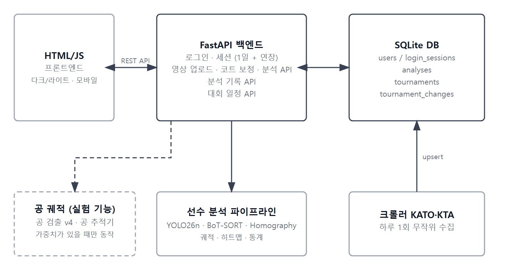
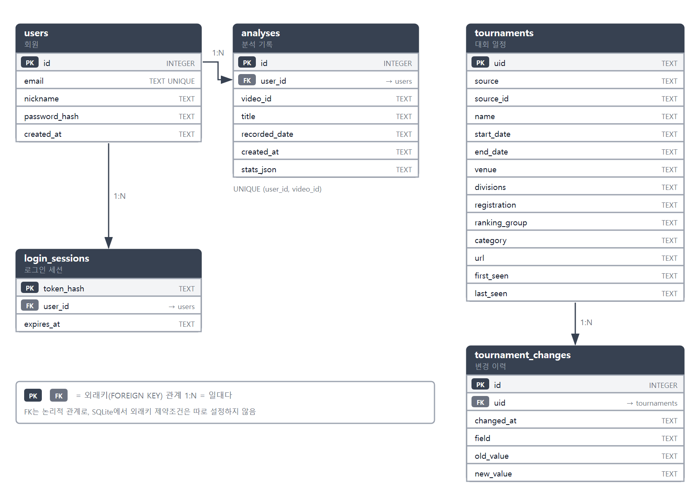
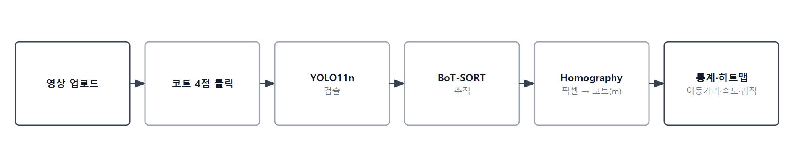

<div align="center">

# CourtVision

YOLO11n·BoT-SORT·Homography·INT8 경량화를 적용한 **컴퓨터비전 풀스택 웹 서비스**

`Python` · `YOLO11n` · `BoT-SORT` · `OpenVINO` · `FastAPI` · `SQLite` · `Docker`

</div>

---

## 1. 프로젝트 개요

- **배경:** 아마추어 테니스 선수는 경기 영상을 찍어도 분석할 방법이 없고, 국내 대회 일정은 협회 사이트마다 흩어져 있음
- **목표:** 영상 업로드 → 선수 추적 → 실제 코트 좌표(m) 변환 → 통계·히트맵 출력 / 대회 일정 자동 수집·조회
- **기간:** 2026.09 – 2026.10
- **규모:** 영상 분석 파이프라인 1개 · 공 검출 파인튜닝 v1~v3a · INT8 경량화 실험 1회 · FastAPI 백엔드 · 크롤러 2개

| 영역 | 기술 | 사용 이유 |
| --- | --- | --- |
| 객체 검출·추적 | YOLO11n, BoT-SORT | 경량 검출기 + 재ID 기반 추적으로 선수 궤적 유지 |
| 좌표 변환 | OpenCV Homography | 화면 픽셀 좌표를 실제 코트 좌표(m)로 변환 |
| 경량화 | NNCF + OpenVINO INT8 | 모델 크기 68%↓, CPU 추론 약 1.7배 향상 |
| 크롤링 | requests, BeautifulSoup | 서버 렌더링 페이지라 Selenium 불필요, 하루 1회 무작위 수집 |
| 백엔드 | FastAPI, SQLite | 로그인·세션·분석 기록 API, 단일 인스턴스 운영 |
| 환경 | Docker Compose | 서비스·크롤러 컨테이너 묶음 로컬 실행 확인 |

**서비스 구조**

<p align="center">
  
</p>

**DB 관계도**

<p align="center">
  
</p>

**영상 분석 흐름**

<p align="center">
  
</p>

---

## 2. 주요 화면

| 홈 화면 | 영상 분석 | 대회 일정 |
| --- | --- | --- |
|  |  |  |
| ① 분석 결과 요약, 다크/라이트·모바일 지원 | ② 4단계 위저드, 코트 4점 클릭 → 추적·히트맵 | ③ KATO·KTA 일정 수집, 출처·부별·접수중 필터 |

---

## 3. 구현 내용

### 3-1. 영상 분석 파이프라인

- 영상 업로드 → 코트 4점 클릭 → YOLO11n 선수 검출 → BoT-SORT 추적
- OpenCV Homography로 화면 좌표를 실제 코트 좌표(m)로 변환
- 이동거리·평균 속도·최고 속도·궤적·히트맵 산출
- 4단계 스텝 위저드 UI로 한 단계씩 진행

### 3-2. 공 검출 파인튜닝 (v1 → v2 채택)

video9 기준, 20px 이내 적중률 / 오검출률 (conf 0.35)

| 모델 | 적중률 | 오검출률 | 비고 |
| --- | --- | --- | --- |
| v1 | 92.9% | 37.6% | |
| **v2 (채택)** | **95.3%** | **15.6%** | 배경 이미지 571장 추가 |
| v3 | 92.9% | 21.8% | 공개 데이터 추가 → 오히려 악화 |
| v3a | 99.4% | 31.6% | 배경 보정 가설 → 기각 |

### 3-3. INT8 경량화

CPU(Xeon W-2223), 입력 544×960, 300프레임 기준

| | PyTorch FP32 | OpenVINO FP32 | OpenVINO INT8 |
| --- | --- | --- | --- |
| 프레임당 시간 | 72.2 ms | 85.7 ms | **50.0 ms** |
| 모델 크기 | 5.6 MB | 10.9 MB | **3.5 MB** |

서비스 지표(video9 전체): 이동거리 33.83 m → 33.99 m (+0.5%), 평균 속도 거의 동일, 최고 속도 −8%

### 3-4. 크롤링·DB

- KATO·KTA 공개 일정 수집, `requests + BeautifulSoup` (서버 렌더링 확인 후 선택)
- `upsert()`로 신규·변경·동일 구분, 변경 이력 테이블 별도 관리
- 하루 1회, 매번 다른 무작위 시각에 수집 (정중한 크롤링)

---

## 4. 문제 해결 경험

### 1) INT8 1차 측정 조건 불일치 → 폐기·재측정

- **문제:** FP32와 INT8 측정 결과가 같은 가중치인데 과도하게 차이 남
- **원인 분석:** 입력 크기 불일치 — FP32는 960×544(직사각형), INT8은 960×960(정사각형)
- **해결:** 조건 맞춰 재측정, 1차 결과는 로그만 남기고 폐기
- **결과:** 조건 통일 후 프레임당 72.2 ms → 50.0 ms, 서비스 지표도 함께 비교

### 2) 공 검출 v3 — 데이터 추가가 오히려 성능 악화

- **문제:** 공개 데이터 추가(v3)했는데 적중률이 v1 수준으로 복귀, 오검출도 증가
- **원인 분석:** 공개 데이터 화질·조건이 CCTV 환경과 달라 분포 충돌 가능성
- **해결:** 배경 보정 가설(v3a) 세워 재검증 → 오검출 개선 없음으로 가설 기각, v2 최종 채택

### 3) 크롤링 도구 선택

- **문제:** Selenium 사용 여부 판단 필요
- **원인 분석:** KATO·KTA가 서버 렌더링 — 응답 HTML에 표가 그대로 존재 확인
- **해결:** `requests + BeautifulSoup`으로 단순화, Selenium 불필요

---

## 5. 한계와 개선 방향

- **공 추적 미구현:** 검출까지만 — 프레임 간 궤적 연결 및 서비스 연동 미완료
- **이동거리·속도 미검증:** 실측값과 비교하지 않아 참고용 추정값
- **코트 보정 수동:** 4점 클릭 방식 — 자동 코트 인식 미구현
- **INT8 서비스 미연결:** 경량화 실험만 완료, 서비스 적용은 아직
- **실험 단일 샘플:** 대부분 영상 1개·측정 1회 기준 — 일반화 한계
- **학습 데이터 부족:** 모델 성능 향상을 위해 다양한 환경·조건의 영상과 어노테이션 데이터를 추가로 수집·학습해야 함

---

<details>
<summary><b>실행 방법과 파일 구조</b></summary>

<br />

**로컬 실행**

```bash
cd webapp/backend
pip install -r requirements.txt
uvicorn main:app --port 8000
```

`http://localhost:8000` 접속. 첫 실행 시 YOLO11n 가중치 자동 다운로드.

**Docker**

```bash
docker compose up --build
```

환경변수(선택): `COURTVISION_DB`, `UPLOAD_DIR`, `RESULTS_DIR`, `YOLO_IMGSZ`, `COOKIE_SECURE`

```
webapp/backend/   FastAPI 서버, 파이프라인, 크롤러, DB
webapp/frontend/  단일 HTML/JS 프론트
src/              실험·검증 스크립트
results/          실험 기록 (v2_ball_experiment.md, int8_experiment.md)
docs/             스크린샷, 발표 자료
```

</details>

---

## 6. 프로젝트를 통해 얻은 경험

- **실험 설계:** 조건 불일치로 1차 결과를 직접 폐기하고 재측정 — 측정 환경 통일이 먼저임을 체감
- **데이터 품질:** 데이터 양보다 분포가 중요 — 공개 데이터 추가가 오히려 성능 악화
- **경량화 실용성:** INT8 양자화로 모델 크기 68%↓·속도 1.7배·핵심 서비스 지표 거의 유지 확인
- **설계 판단:** 서버 렌더링 여부 먼저 확인 → 불필요한 도구(Selenium) 제거
