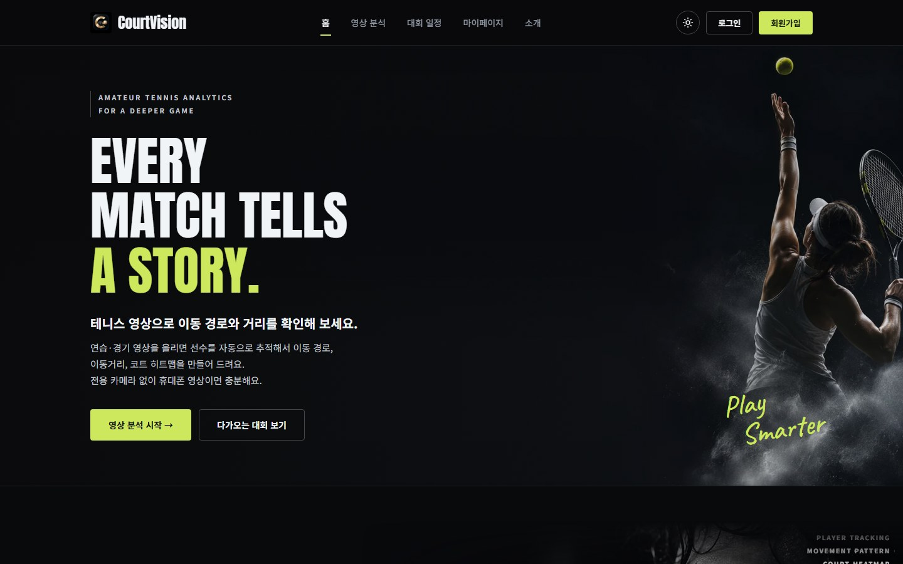
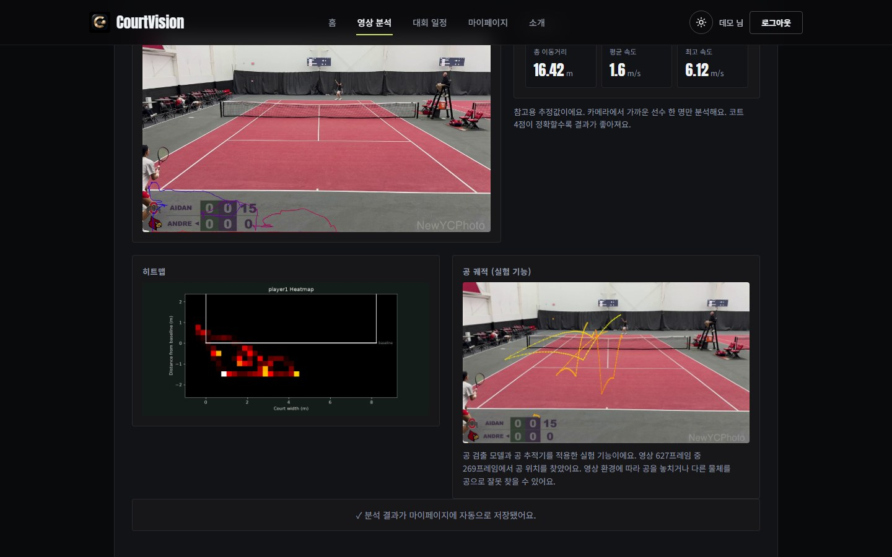
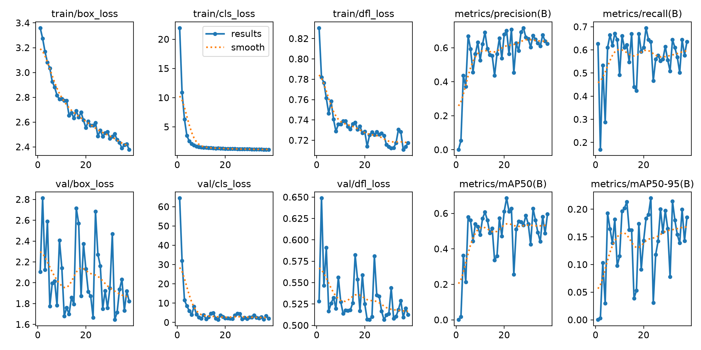
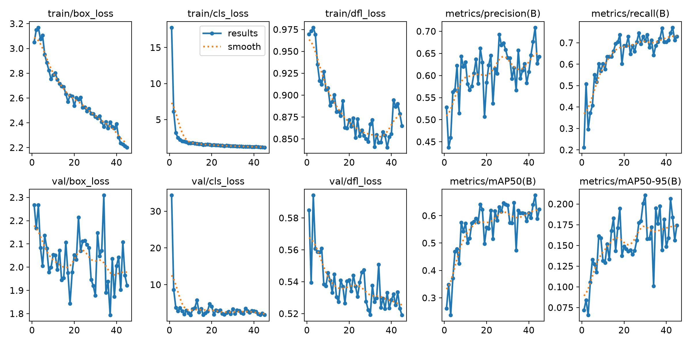
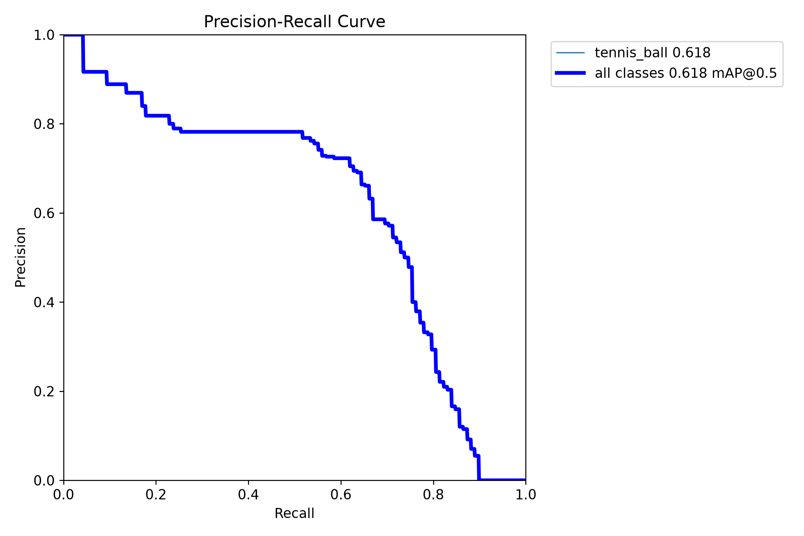
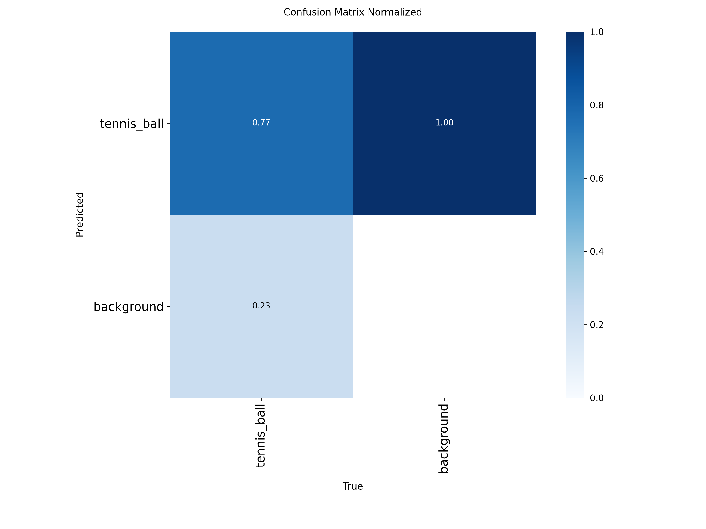

<div align="center">

# CourtVision

**아마추어 선수 테니스 경기 영상 분석 서비스**

YOLO11n·BoT-SORT·Homography·INT8 경량화를 적용한 컴퓨터비전 풀스택 웹 서비스

</div>

---

## 1. 프로젝트 개요

- **배경:** 아마추어 테니스 선수는 경기 영상을 찍어도 분석할 방법이 없고, 국내 대회 일정은 협회 사이트마다 흩어져 있음
- **목표:** 영상 업로드 → 선수 추적 → 실제 코트 좌표(m) 변환 → 궤적·히트맵 출력 / 대회 일정 자동 수집·조회
- **기간:** 2026.09 – 2026.10
- **규모:** 영상 분석 파이프라인 1개 · 공 검출 파인튜닝 v1~v3a · INT8 경량화 실험 1회 · FastAPI 백엔드 · 크롤러 2개 · pytest 62개

### 기술 스택


| 영역 | 기술 | 사용 이유 |
| --- | --- | --- |
| 객체 검출·추적 | YOLO11n, BoT-SORT | 경량 검출기 + 재ID 기반 추적으로 선수 궤적 유지 |
| 좌표 변환 | OpenCV Homography | 화면 픽셀 좌표를 실제 코트 좌표(m)로 변환 |
| 경량화 | NNCF + OpenVINO INT8 | 모델 크기 68%↓, CPU 추론 약 1.7배 향상 (서비스 미연결) |
| 크롤링 | requests, BeautifulSoup | 서버 렌더링 페이지라 Selenium 불필요, 하루 1회 무작위 수집 |
| 백엔드 | FastAPI, SQLite | 로그인·세션·분석 기록 API, 단일 인스턴스 운영 |
| 프론트엔드 | HTML·CSS·JavaScript | 프레임워크 없는 단일 페이지, 다크/라이트·모바일 대응 |
| 환경 | Docker Compose | 서비스·크롤러 컨테이너 묶음 로컬 실행 확인 |
| 테스트 | pytest | 저장·파서·계정·API·좌표 변환 자동 검증 |

### 핵심 역량

| 역량 | 내용 |
| --- | --- |
| 영상 분석 파이프라인 | 검출 → 추적 → 좌표 변환 → 궤적·히트맵 |
| 통제된 실험 설계 | 실험마다 변수 1개 변경, 동일 검증 기준(video9, 20px 이내 적중) 적용 |
| 가설 검증 | 공개 데이터 추가 후 성능 악화 → 배경 비율 가설 설정 → 재실험으로 기각 |
| 측정 조건 점검 | INT8 1차 측정의 입력 크기 불일치 발견, 1차 결과 폐기·재측정 |
| 모델 경량화 | NNCF·OpenVINO INT8 양자화, FP32 대비 검출 유지율·추적 결과 비교 |
| 데이터 수집·관리 | `upsert()` 신규/변경/동일 구분, 변경 이력 테이블, 일 1회 무작위 시각 수집 |
| 자동 테스트 | pytest 62개, 버그 주입(변이) 확인으로 테스트 검출력 점검 |
| 한계 기록 | 실험별 한계·미검증 항목 문서 명시 |

**서비스 구조**

<p align="center">
  
</p>

**DB 관계도**

<p align="center">
  
</p>

**영상 분석 흐름**

<p align="center">
  
</p>

---

## 2. 주요 화면

| 홈 화면 | 영상 분석 | 대회 일정 |
| --- | --- | --- |
|  |  |  |
| ① 분석 결과 요약, 다크/라이트·모바일 지원 | ② 4단계 위저드, 코트 4점 클릭 → 추적·히트맵 | ③ KATO·KTA 일정 수집, 출처·부별·접수중 필터 |

---

## 3. 구현 내용

### 3-1. 영상 분석 파이프라인

- 영상 업로드 → 코트 4점 클릭 → YOLO11n 선수 검출 → BoT-SORT 추적
- OpenCV Homography로 화면 좌표를 실제 코트 좌표(m)로 변환
- 선수별 이동 궤적·코트 히트맵 산출
- 4단계 스텝 위저드 UI로 한 단계씩 진행, 로그인 시 촬영일별 저장

### 3-2. 공 검출 파인튜닝 (v1 → v2 채택)

video9 기준, 20px 이내 적중률 / 오검출률 (conf 0.35)

| 모델 | 적중률 | 오검출률 | 비고 |
| --- | --- | --- | --- |
| v1 | 92.9% | 37.6% | 배경 이미지 0장 |
| **v2 (채택)** | **95.3%** | **15.6%** | 배경 이미지 571장 추가 |
| v3 | 92.9% | 21.8% | 공개 데이터 1,457장 추가 → 오히려 악화 |
| v3a | 99.4% | 31.6% | v3 + 배경 491장 → 가설 기각 |

학습 곡선: v2 (채택, 38 epoch 조기 종료)

<p align="center">
  
</p>

- 학습 손실(box·cls·dfl): 전 구간 감소
- 검증 손실·mAP50: epoch 간 변동 큼(초반 제외 mAP50 약 0.25~0.69), 검증 이미지 202장
- 최고 epoch 선택(epoch 21, mAP50 0.686)에 변동 영향 포함
- 공 검출은 서비스 미연결, 추적 미구현

<details>
<summary><b>v1·v3·v3a 학습 곡선, v2 PR 곡선·혼동 행렬, conf별 결과</b></summary>

<br />

| 모델 | 종료 | 최고 mAP50 |
| --- | --- | --- |
| v2 | 38 epoch | 0.686 (epoch 21) |
| v3 | 38 epoch | 0.650 (epoch 31) |
| v3a | 46 epoch | 0.674 (epoch 43) |






| conf | v1 적중 | v1 오검출 | v2 적중 | v2 오검출 |
| --- | --- | --- | --- | --- |
| 0.25 | 98.2% | 47.7% | 98.2% | 23.3% |
| 0.35 | 92.9% | 37.6% | 95.3% | 15.6% |
| 0.45 | 62.4% | 29.9% | 68.2% | 9.2% |
| 0.55 | 20.0% | 14.9% | 4.7% | 0.4% |

- 권장 conf 0.35
- v2는 전체 점수 하락으로 conf 0.55 이상에서 실제 공도 미검출

</details>

### 3-3. INT8 경량화

CPU(Xeon W-2223), 입력 544×960, 300프레임 기준

| | PyTorch FP32 | OpenVINO FP32 | OpenVINO INT8 |
| --- | --- | --- | --- |
| 프레임당 시간 | 72.2 ms | 85.7 ms | **50.0 ms** |
| 모델 크기 | 5.6 MB | 10.9 MB | **3.5 MB** |

FP32 대비 검출 유지 (기준: PyTorch FP32 검출 결과)

| 항목 | INT8 |
| --- | --- |
| 검출 재현율 | 97.8% |
| 정밀도 | 91.5% |
| 상위 2트랙 길이(/300) | 300, 298 (FP32 300, 299) |

- 선수 2명 추적 트랙: 경량화 후에도 유지
- 캘리브레이션: video2 균등 간격 300프레임, 평가 영상(video9)과 분리

### 3-4. 크롤링·DB

- KATO·KTA 공개 일정 수집, `requests + BeautifulSoup` (서버 렌더링 확인 후 선택)
- `upsert()`로 신규·변경·동일 구분, 변경 이력 테이블 별도 관리
- 수집 주기: 일 1회, 매번 다른 무작위 시각 / 서버 기동 시 마지막 수집 24시간 경과 시 보충
- 정중한 크롤링: User-Agent에 프로젝트 정보 명시, 요청 간 지연
- 외부 텍스트는 `textContent`로만 삽입(XSS 방지), https 링크만 허용

### 3-5. Docker

- 이미지 빌드, 컨테이너 기동, `localhost:8000` 응답 확인
- 컨테이너 내 크롤러 동작 확인
- 외부 접속 가능한 서버 배포는 미수행

### 3-6. 테스트

`pytest` 62개, 로컬 통과

| 대상 | 검증 내용 |
| --- | --- |
| 크롤러 저장 (`store.py`) | 신규·변경·동일 구분, 변경 이력, 빈 값 처리, 기간별 상태·필터 |
| 크롤러 파서 (`kato.py`·`kta.py`) | 샘플 HTML 파싱, 날짜 형식 오류 행 제외, 표 구조 변경 시 예외 |
| 계정 (`accounts.py`) | 비밀번호 해시·솔트, 세션 만료, 사용자 간 기록 격리 |
| API (`main.py`) | 가입·로그인·로그아웃, 인증 필요 엔드포인트, 업로드·프레임 선택 |
| 좌표 변환 (`pipeline.py`) | 공식 코트 규격 기준 가상 카메라 → Homography 복원(서비스라인~네트 6.40m 등), 클릭 순서 무관, 합성 이동 데이터 기반 분석 통계 계산 |

- 변이 확인: 임시 복사본에 버그 6종 주입(변경 감지 제거, 코트 기준 좌표 오류, 타 사용자 기록 삭제 허용, 만료 세션 허용, 통계 계산 오류, 비밀번호 검증 우회) → 6종 모두 테스트 실패
- 검출 모델은 가짜 모듈로 대체, 검출 품질은 테스트 범위 밖
- 실행: `pip install pytest httpx` 후 `pytest`

### 3-7. 데이터

| 용도 | 내용 |
| --- | --- |
| 공 검출 학습 | 영상 video1~10 + 공 중심점 좌표(`_ball.csv`) → 16×16px 박스 변환, 2프레임당 1장 |
| 공 검출 구성 | v2: Train 1,583장 / Val 202장(video9·10), 영상 단위 분리(프레임 누수 방지) |
| 공개 데이터 | Roboflow Tennis Ball and Court Detection(CC BY 4.0) 1,457장 (v3) |
| INT8 캘리브레이션 | video2 균등 간격 300프레임 |
| 대회 일정 | KATO·KTA 공개 일정, 사실 정보 요약 + 원본 링크 |

---

## 4. 문제 해결 경험

### 1) INT8 1차 측정 조건 불일치 → 폐기·재측정

- **문제:** FP32와 INT8 측정 결과가 같은 가중치인데 과도하게 차이 남
- **원인 분석:** 입력 크기 불일치 — PyTorch는 960×544(직사각형), OpenVINO는 960×960(정사각형)으로 내보냄
- **해결:** 조건 맞춰 재측정, 1차 결과는 로그만 남기고 폐기
- **결과:** 조건 통일 후 프레임당 72.2 ms(PyTorch FP32) → 50.0 ms(INT8), FP32 대비 검출 재현율 97.8%·상위 2트랙 유지 확인

### 2) 공 검출 v3 — 데이터 추가가 오히려 성능 악화

- **문제:** 공개 데이터 추가(v3) 후 적중률이 v1 수준으로 복귀, 오검출도 증가
- **원인 분석:** 방송 화면 위주 공개 데이터라 검증 영상과 도메인이 다를 가능성(추정, 미검증)
- **해결:** 배경 비율 희석 가설(v3a) 세워 재검증 → 오검출 오히려 증가, 가설 기각, v2 최종 채택

### 3) 크롤링 도구 선택

- **문제:** Selenium 사용 여부 판단 필요
- **원인 분석:** KATO·KTA가 서버 렌더링 — 응답 HTML에 표가 그대로 존재 확인
- **해결:** `requests + BeautifulSoup`으로 단순화, Selenium 불필요

### 4) 테스트가 버그를 놓침 — 정답을 코드 상수에서 가져온 문제

- **문제:** 버그 주입 확인에서 코트 기준 좌표 오류 1종이 테스트를 통과
- **원인 분석:** 테스트가 정답(코트 규격)을 `pipeline.py`의 상수에서 가져와, 상수가 틀리면 정답도 같이 틀림
- **해결:** 공식 코트 규격을 테스트에 독립적으로 기재
- **결과:** 버그 6종 모두 테스트에서 검출

---

## 5. 한계와 개선 방향

- **공 추적 미구현:** 검출까지만 — 프레임 간 궤적 연결 및 서비스 연동 미완료
- **궤적·히트맵 미검증:** 실제 위치와 비교하지 않아 참고용 추정값
- **코트 보정 수동:** 4점 클릭 방식 — 자동 코트 인식 미구현
- **INT8 서비스 미연결:** 경량화 실험만 완료, 서비스 적용은 아직
- **실험 단일 샘플:** 대부분 영상 1개·측정 1회 기준 — 일반화 한계
- **공 검출 검증:** 영상 1개(video9, best epoch 선택에도 사용), 학습 1회, 검증 곡선 epoch 간 변동 큼
- **테스트:** 영상 → 검출 → 통계 전체 흐름, 프론트 화면 자동 테스트 없음 / 좌표 변환 검증은 가상 카메라 기준, 실제 촬영 영상 검증 아님
- **배포:** Docker 로컬 실행까지, 외부 접속 가능한 서버 배포 미수행
- **학습 데이터 부족:** 모델 성능 향상을 위해 다양한 환경·조건의 영상과 어노테이션 데이터를 추가로 수집·학습해야 함

---

<details>
<summary><b>실행 방법과 파일 구조</b></summary>

<br />

**로컬 실행**

```bash
cd webapp/backend
pip install -r requirements.txt
uvicorn main:app --port 8000
```

`http://localhost:8000` 접속. 첫 실행 시 YOLO11n 가중치 자동 다운로드. 세션이 메모리에 저장되므로 워커 1개로 실행.

**Docker**

```bash
docker compose up --build
```

**테스트**

```bash
pip install pytest httpx
pytest
```

환경변수(선택): `COURTVISION_DB`, `UPLOAD_DIR`, `RESULTS_DIR`, `YOLO_IMGSZ`, `COOKIE_SECURE`(HTTPS 배포 시 1)

```
webapp/backend/   FastAPI 서버, 파이프라인, 크롤러, DB
webapp/frontend/  단일 HTML/JS 프론트
tests/            pytest 자동 테스트
src/              실험·검증 스크립트
results/          실험 기록 (v2_ball_experiment.md, int8_experiment.md)
docs/             스크린샷, 다이어그램, 학습 곡선, 발표 자료
```

</details>

---

## 6. 프로젝트를 통해 얻은 경험

- **실험 설계:** 조건 불일치로 1차 결과를 직접 폐기하고 재측정 — 측정 환경 통일이 먼저임을 체감
- **데이터 품질:** 데이터 양보다 분포가 중요 — 공개 데이터 추가가 오히려 성능 악화
- **경량화 실용성:** INT8 양자화로 모델 크기 68%↓·속도 1.7배, FP32 대비 검출·추적 결과 유지 확인
- **설계 판단:** 서버 렌더링 여부 먼저 확인 → 불필요한 도구(Selenium) 제거
- **테스트 설계:** 테스트의 정답은 코드와 독립적으로 기재, 버그 주입으로 검출력 확인
- **협업 방식:** 구현은 AI(Claude)와 협업, 요구사항 정의·결과 검토·검증 질문 담당

---

## 7. 데이터 출처

- 대회 정보: [한국테니스발전협의회(KATO)](https://kato.kr), 대한테니스협회(KTA) 공개 일정 요약, 정확한 내용은 각 대회 원본 링크 확인
- 화면 사진: AI 생성 이미지
